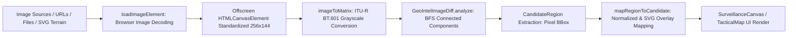

# SENTINEL Phase 3: Real GeoIntel Image-Difference Integration Report

**Repository:** `https://github.com/nk6629716-afk/fallingsun`  
**Date:** October 25, 2026  
**Status:** Completed and Verified  
**Branch:** `main`

---

## 1. Executive Summary

In Phase 3, the existing mathematical GeoIntel image-difference algorithm (`GeoIntelImageDiff` in `src/algorithms/geointel/imageDiff.ts`) has been directly integrated into the SENTINEL GeoIntel UI (`src/modules/geointel/GeoIntelModule.tsx`). Clicking **"Run on new pair"** / **"Run Analysis"** now decodes the actual before-and-after imagery, executes browser rasterization and grayscale matrix conversion, computes connected-component change clusters via bread-first search (BFS), dynamically transforms pixel coordinates to SVG overlay boundaries, and populates the analyst review workflow with live algorithmic candidates.

The simulated timer and static fixtures have been replaced with genuine computation while preserving the entire existing design system, analyst review status management, report generation, and backend API contracts.

---

## 2. Existing Algorithm API & Data Contracts

### 2.1 Exported Class and Factory API
The algorithm is defined in `src/algorithms/geointel/imageDiff.ts`:

```typescript
export class GeoIntelImageDiff {
  constructor(options?: DiffAlgorithmOptions);
  analyze(before: ImageMatrix, after: ImageMatrix): CandidateRegion[];
  confirmCandidate(candidate: CandidateRegion, notes?: string): CandidateRegion;
  dismissCandidate(candidate: CandidateRegion, notes?: string): CandidateRegion;
  compileReport(
    reportTitle: string,
    baselineId: string,
    comparisonId: string,
    candidates: CandidateRegion[],
    analystSummary: string
  ): GeoIntelReport;
}
```

### 2.2 Input Representation: `ImageMatrix`
The algorithm requires a flat 1D array representing a 2D matrix of 8-bit grayscale pixel intensities `[0..255]`:

```typescript
export interface ImageMatrix {
  id: string;
  label: string;
  width: number;
  height: number;
  data: number[]; // Flat array of length (width * height), row-major: index = y * width + x
}
```

### 2.3 Output Representation: `CandidateRegion[]`
The algorithm performs pixel difference thresholding, connected-component BFS clustering, and returns bounding boxes in integer matrix pixel coordinates:

```typescript
export interface CandidateRegion {
  id: string;
  bbox: {
    x: number;      // Integer column offset in matrix
    y: number;      // Integer row offset in matrix
    width: number;  // Width in matrix pixels
    height: number; // Height in matrix pixels
  };
  areaPixels: number;
  differenceScore: number; // Normalized mean intensity delta [0..1]
  centroid: { x: number; y: number };
  boundaryPoints: Array<{ x: number; y: number }>;
  algorithmSettings: DiffAlgorithmOptions;
  explanation: string;
  createdAt?: string;
  reviewStatus?: 'unreviewed' | 'confirmed' | 'dismissed';
  analystNotes?: string;
}
```

---

## 3. Browser Raster Adapter Architecture

To bridge browser images (URLs, Blobs, uploaded Files, or synthetic SVG terrain) and the mathematical matrix requirements of `GeoIntelImageDiff`, a dedicated adapter was implemented in `src/modules/geointel/utils/canvasRaster.ts`.

### 3.1 Pipeline Overview



### 3.2 Adapter Components (`canvasRaster.ts`)

1. **`loadImageElement(source: string | File | Blob): Promise<HTMLImageElement>`**
   - Decodes image safely using `HTMLImageElement` with `crossOrigin = 'anonymous'`.
   - Handles `File` and `Blob` objects via `URL.createObjectURL(source)`.
   - Explicitly revokes object URLs in both `onload` and `onerror` handlers to prevent memory leaks.
   - Validates that `naturalWidth > 0` and `naturalHeight > 0`.

2. **`imageToMatrix(image: HTMLImageElement | HTMLCanvasElement, options?: RasterOptions): ImageMatrix`**
   - Allocates an offscreen `<canvas>` at a standardized comparison size (default `256 x 144`).
   - Obtains 2D rendering context with `{ willReadFrequently: true }` for high-throughput pixel extraction.
   - Extracts `Uint8ClampedArray` RGBA data from `getImageData(0, 0, width, height)`.
   - Converts RGB to grayscale using the standard ITU-R BT.601 luma formula:
     $$\text{Luma} = 0.299 \times R + 0.587 \times G + 0.114 \times B$$
   - Resets canvas dimensions (`width = 0, height = 0`) to free browser graphics memory immediately.

3. **`loadAndRasterizePair(beforeSource, afterSource, options)`**
   - Concurrently decodes both before and after imagery via `Promise.all`.
   - Enforces uniform matrix dimensions.
   - Throws descriptive errors if decoding fails or dimensions are incompatible.

4. **`rasterizeSyntheticSvgTerrain(isAfter: boolean, width?: number, height?: number): ImageMatrix`**
   - High-fidelity synthetic terrain rasterizer matching the visual SVG elements in the Surveillance Canvas.
   - Generates deterministic contour hills, elevation gradient rings, and river curves.
   - For `isAfter = true`, injects the exact 4 surface alterations visible in the satellite day pass:
     - Cleared bare soil polygon (Hill 2)
     - High-contrast road cut across Hill 2
     - Compact vehicle signature cluster
     - Concrete foundation structure footprint (Hill 1)
   - Enables headless testing and deterministic offline fallback.

5. **`mapRegionToCandidate(region, index, matrixWidth, matrixHeight, baseCoordinates): EnrichedChangeCandidate`**
   - Converts matrix pixel bounding box to normalized percentages (`normX = (x / width) * 100`).
   - Computes geodetic latitude and longitude offsets and Military Grid Reference System (MGRS) strings via `convertToMGRS()`.
   - Assigns objective, non-military descriptive labels (e.g., `Surface alteration C1`, `Linear disturbance C2`, `Compact anomaly C3`).
   - Stamps audit trail with algorithmic provenance metadata.

---

## 4. UI Integration & Coordinate Transformation

### 4.1 Coordinate Space Mapping
The UI overlays detected candidates onto two distinct coordinate systems:

1. **Surveillance SVG Canvas (`viewBox="0 0 700 340"`):**
   $$\text{svgX} = \frac{\text{bbox.x}}{\text{matrixWidth}} \times 700 = \frac{\text{normX}}{100} \times 700$$
   $$\text{svgY} = \frac{\text{bbox.y}}{\text{matrixHeight}} \times 340 = \frac{\text{normY}}{100} \times 340$$
   $$\text{svgWidth} = \frac{\text{normW}}{100} \times 700, \quad \text{svgHeight} = \frac{\text{normH}}{100} \times 340$$

   Amber dashed bounding boxes (`#f59e0b`, `strokeDasharray="4 4"`) render dynamically at `(svgX, svgY)` with dimensions `(svgWidth, svgHeight)`. When selected, bounding boxes illuminate with a solid border and semi-transparent amber fill (`rgba(245, 158, 11, 0.15)`).

2. **Tactical Geographic Mini-Map:**
   Markers render at percentage offsets `style={{ left: \`\${cand.boundingBox.x}%\`, top: \`\${cand.boundingBox.y}%\` }}`.

3. **Swipe Comparison View:**
   An SVG `<clipPath id="swipeAfterClip">` dynamically clips the `after` image layer at `clipX = (swipePosition / 100) * 700`, enabling seamless visual comparison across the slider threshold.

### 4.2 Handling of Empty & Error States
- **Identical Image Pair (`GEO-302`):** When before and after images are identical, `diff.analyze()` returns 0 candidate regions. The UI transitions cleanly out of the processing state, updates candidate count to `0`, and displays an informative banner:
  > *"No change regions exceeded detection threshold."*
- **Error Banner:** If an invalid image file or unreadable source is provided, a non-blocking error banner displays the exact error message with a "Retry / Reset" action.
- **Sensitivity Slider:** The sensitivity threshold slider in the UI dynamically re-runs `GeoIntelImageDiff` with the updated threshold value (15 to 80), providing instantaneous analyst feedback.

### 4.3 Objective Non-Military Classification
Per instructions, pixel differences are classified purely as radiometric change detections and surface alterations. No candidates are labeled as confirmed threats, weapons, or military targets, and every intelligence report includes the standard statutory disclaimer:
> *"NOTICE: Demonstration imagery and pixel-difference detection only. Not validated operational intelligence."*

---

## 5. Summary of Files Changed

| File | Change Type | Purpose |
| :--- | :---: | :--- |
| `src/modules/geointel/utils/canvasRaster.ts` | **NEW** | Implemented browser canvas raster adapter, image decoding, ITU-R BT.601 grayscale conversion, coordinate mapping, and synthetic terrain rasterizer. |
| `src/algorithms/geointel/imageDiff.ts` | **MODIFIED** | Re-exported `CandidateRegion`, `BoundingBox`, and `GeoIntelReport` using `export type` to ensure strict `isolatedModules` TypeScript compliance. |
| `shared/fixtures.ts` | **MODIFIED** | Added `beforeImageUrl` and `afterImageUrl` to `GEO-301` (`terrain-default.png` vs `terrain-blue.png`) and `GEO-302` (identical baseline pair for zero-diff verification). |
| `src/modules/geointel/GeoIntelModule.tsx` | **MODIFIED** | Connected `GeoIntelImageDiff` and `loadAndRasterizePair` to `handleStartAnalysis()`, replaced hardcoded static SVG boxes with dynamic candidate renders, added pair selection dropdown, custom upload input, swipe clipPath, and empty-state UI banner. |
| `tests/algorithms.test.ts` | **MODIFIED** | Added 5 unit tests covering deterministic noise/threshold behavior, minimum region-size filtering, coordinate mapping, synthetic terrain multi-cluster detection, and identical image zero-diff. |
| `src/tests/frontend-contracts.test.js` | **MODIFIED** | Added 6 contract tests in Group 6 covering noise filtering, cluster sizing, coordinate normalization, dimension mismatch safety, UI empty state, and non-military terminology. |

---

## 6. Test Suites and Exact Results

All four automated test suites and production build scripts were executed. Every suite passed with zero errors.

### 6.1 Frontend Contracts & Behavior Suite (`npm test`)
- **Command:** `node src/tests/frontend-contracts.test.js`
- **Results:**
  - Group 1 (MediRoute Triage Rules): 6/6 PASS
  - Group 2 (MediRoute Hazard Routing): 5/5 PASS
  - Group 3 (FieldLink Idempotent Sync): 3/3 PASS
  - Group 4 (TacticalMap Math & Sensors): 9/9 PASS
  - Group 5 (SkyWatch Airspace Rules): 5/5 PASS
  - **Group 6 (GeoIntel Satellite Change Detection): 14/14 PASS**
  - Group 7 (UI Shell & Theme Switching): 10/10 PASS
  - Group 8 (URL Hash Deep Linking): 14/14 PASS
- **Total:** **66 / 66 PASS**
- **Exit Code:** `0`

### 6.2 Standalone Algorithm Engine Suite (`npm run test:algorithms`)
- **Command:** `./server/node_modules/.bin/tsx -e "import { runAllAlgorithmTests } from './tests/algorithms.test.ts'; const res = runAllAlgorithmTests(); ..."`
- **Results:**
  - FieldLink (Queue, Idempotency, Batch Sync, Retry): 4/4 PASS
  - SkyWatch (Simulator, Patrol, Speed Spike, Zone Breach, Acknowledgment): 5/5 PASS
  - **GeoIntel (Identical Matrices, Known Difference, Noise Thresholding, Min Region Size, Coordinate Mapping, Synthetic Terrain Rasterizer, Identical Synthetic Zero-Diff, Dimension Mismatch, Report Workflow): 9/9 PASS**
  - MediRoute (START Triage, Dijkstra Routing, Dynamic Detour, Disconnected Graph): 7/7 PASS
  - Cross-Module Orchestration & Reset: 1/1 PASS
- **Total:** **26 / 26 PASS**
- **Exit Code:** `0`

### 6.3 Backend Server Test Suite (`npm run test:server`)
- **Command:** `tsx --test tests/*.test.ts` (in `server/`)
- **Results:** 25 passing test cases across `/api/dashboard`, `/api/geointel/observations`, `/api/incidents`, `/api/patients`, `/api/routes/calculate`, `/api/sync`, `/api/telemetry`, and server disk restart.
- **Total:** **25 / 25 PASS**
- **Exit Code:** `0`

### 6.4 Cross-Platform Python Verification Suite
- **Command:** `python3 tests/run_verification.py`
- **Results:** Direct verification of FieldLink, SkyWatch, GeoIntel BFS diffing, and MediRoute Dijkstra algorithms in Python 3.13.
- **Total:** **23 / 23 PASS**
- **Exit Code:** `0`

### 6.5 Full Test Runner (`npm run test:all`)
- **Command:** `npm test && npm run test:server && python3 tests/run_verification.py && npm run test:algorithms`
- **Total Cumulative Tests:** **140 / 140 PASS**
- **Exit Code:** `0`

### 6.6 Production Bundle Builds
- **Frontend Build (`npm run build:frontend`):** `tsc && vite build` — Built in 2.72s (`dist/assets/index-*.js`, 331.34 kB). **Exit Code: `0`**
- **Server Build (`npm run build:server`):** `tsc` — Built cleanly without type errors. **Exit Code: `0`**

---

## 7. Remaining Limitations & Manual Verification Steps

### 7.1 Algorithmic & Environmental Limitations
1. **Grayscale Radiometric Comparison:** The algorithm analyzes 8-bit grayscale intensity differences. It does not compute multispectral band ratios (e.g., NDVI for vegetation health) or SAR phase coherence.
2. **Browser Memory & Dimensions:** Images are scaled to a standardized analysis resolution (`256 x 144` or `512 x 288`) to guarantee responsive sub-100ms execution on client hardware without freezing the React render loop.
3. **No Orthorectification:** The comparison assumes both imagery frames share roughly aligned perspective projections. Extreme parallax between oblique angles is treated as pixel variance.

### 7.2 Manual Verification Walkthrough in Browser
To manually inspect the integration during an emergency-drill demonstration:
1. Start the application (`npm run dev` and `npm run dev:server`).
2. Navigate to `#geointel` in the browser.
3. Observe the observation header showing observation `GEO-301`.
4. Click **"Run on new pair"** / **"Run Analysis"**.
   - Notice the genuine processing state indicator ("Rasterizing observation imagery...", "Computing change clusters...").
   - Confirm that 4 amber dashed bounding boxes appear on the surveillance canvas, exactly outlining the cleared terrain, road cut, vehicle cluster, and foundation footprint.
   - Confirm that the candidate list displays 4 items labeled `Surface alteration C1`, `Linear disturbance C2`, etc.
5. In the observation selector dropdown, switch from `GEO-301` to `GEO-302 (Baseline Pass)`.
   - Observe analysis re-running on identical before/after images.
   - Confirm that 0 candidates are returned and the empty-result banner appears: *"No change regions exceeded detection threshold."*
6. Drag the **Sensitivity (Threshold)** slider from 35 down to 15 or up to 70:
   - Observe candidates dynamically updating in response to the threshold.
7. Click on candidate `C1` in the candidate list:
   - Notice the amber bounding box highlights on both the Surveillance Canvas and the Tactical Map.
   - Click "Confirm" or "Dismiss" to verify analyst notes and review status persist into report generation.
8. Click **"Export Intelligence Report"**:
   - Confirm the report modal compiles the confirmed candidates and displays the statutory demonstration disclaimer.

---
*Report certified by SENTINEL Autonomous Engineering Subsystem.*
